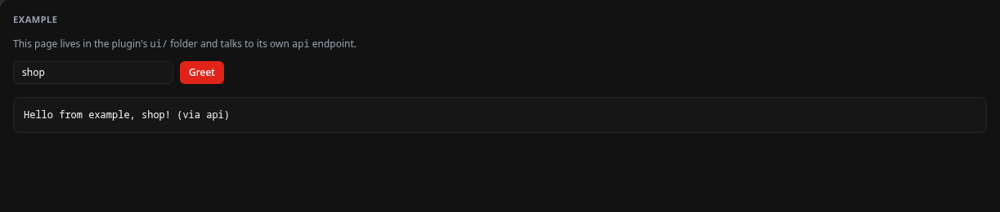

# Lerd plugin example

A small working [Lerd](https://lerd.sh) plugin that uses every surface a plugin can add, so you can see how each one is wired before writing your own. It is what `lerd plugin new <name>` generates, with this README and a license added, and it is the example submission in the [plugin registry](https://github.com/lerd-env/plugins).

## What it adds to Lerd

- **CLI commands**: `lerd example:greet [site]` prints a greeting, `lerd example:sites` lists your sites through Lerd's API
- **Site command**: **Greet** in every site's Commands menu and the command palette
- **Hooks**: on `site.linked` and `site.unlinked`
- **MCP tool and skill**: `example_greet`, with a skill telling your AI assistant when to call it
- **API endpoint**: `GET /api/plugins/example/greet?site=<name>`
- **Dashboard page, site tab and Overview card**: an **Example** page on the rail, an **Example** tab on every site, and a card on the Overview of the sites you switch it on for
- **Page script**: a small button on the pages of the sites you switch the plugin on for, which calls the plugin's own endpoint
- **Its own card in the dashboard**: an icon, screenshots and a DOCS.md, shown on the plugin's Documentation tab once it is installed

Its pages are built from the look Lerd gives every plugin page, so they follow the dashboard's light or dark mode and its theme without a line of colour of their own.



## What it reads, changes and sends

It reads only the site name Lerd hands it. The hooks append each event and its payload to `events.log` in the plugin's own data folder, and nothing else is written. `lerd example:sites` calls Lerd's own API on your machine with the token Lerd gives the plugin. Nothing leaves your machine.

It needs `curl` for `example:sites`, and runs on Lerd 1.38 or newer.

## Install

```bash
lerd plugin install example
```

## Write your own

```bash
lerd plugin new my-plugin
```

Then read the [plugin guide](https://lerd.sh/features/plugins), and when it is ready, submit it to the [registry](https://github.com/lerd-env/plugins#contributing).

## License

MIT
